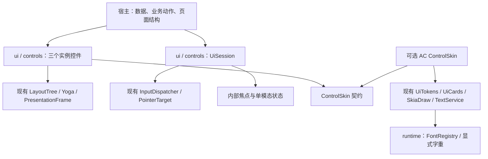

# AtomLib 字体与最小交互控件方案

> 状态：2026-11-01 用户已批准按推荐项实施；唯一实施者按 P0→P6 落实，主代理独立审查已收束并接受修复范围与逻辑，最终候选验证见实施报告。现有实现合同见 `docs/controls.md`，执行证据见 `build/controls-candidate/`。未选发布版本、未提交／推送／发布／部署／启动游戏。
> 本文保留写方案时的设计措辞和预期命令；它们本身不充当执行证明。已实施 API、实际命令及未覆盖项以当前消费文档和独立实施报告为准。子代理同时最多一个，不默认启用其他协作工作流。

> 实施入口：[控件合同](../../controls.md)、[实施报告](../../evidence/minimal-controls-and-fonts/report.md)。下方checkbox保留最初任务拆解，当前进度与审查状态以实施报告为准；新增prepare(viewport)使像素比变化的回滚先于update／Yoga量测，实际接口见控件合同。

> 独审后接口细化：新增 ControlSkin.modalDialogStyle(Viewport)，将模态外层规格归还皮肤；会话只居中组合。三项真实问题（卡片内点击误取消、取消后 held-key repeat 复活事务、绘制与命中层序不一致）均有独审行为红测。另有非 AC 皮肤尺寸与失焦漏 keyup 回归，普通取消与窗口失焦采用不同物理跟踪合同。原有红测保留，最终重新打包／重锁、测试统计与源码摘要以新 results.json 为准。模糊研究不属于本方案已实施范围。

**目标：**让独立创作者只写页面结构、数据与业务动作，就能组合一个具有 AC 观感的“面板宽度滑条＋半屏开关＋危险操作确认窗”，并处理窄宽、中文、真实像素比和取消路径。

**架构：**继续使用现有 Skija 桥、Yoga、`PresentationFrame`、`TextService` 与 `InputDispatcher`。在现有 `ui` 模块增加可选的 `com.atom.lib.controls` 包，提供三个控件及其页级交互会话；AC 美术适配仍放在可选设计包。宿主拥有布局引擎和业务数据，库拥有手势、焦点、模态与控件动效。

**技术基线：**公共代码 Java 17；Skija 0.143.18、types 0.2.0；Forge 1.20.1／Yoga 3.3.1、Fabric 与 NeoForge 1.21.1／Yoga 3.3.3 不变。第一消费者继续用 `D:/AtomLib-Usability` 的 Fabric 1.21.1／JDK21 工程。

## 1. 依据与当前状态

| 事实源 | 本轮已确认的事实 | 证据边界 |
|---|---|---|
| Lib `08370f9`＋工作区审计修复 | 基础栈、默认字体、设计原语存在；三种完整控件不存在 | 现有改动未提交，不得覆盖或混称为公开 beta3 已包含 |
| AC `f6dbaa58`＋工作区审计修复 | 0.4.0，仍钉公开 beta3 | 本方案不改生产 AC 页面、配置、字体包或依赖锁 |
| [独立能力表](/D:/AtomLib-Usability/docs/capability-map.md)、[验收报告](/D:/AtomLib-Usability/docs/report.md) | 静态子集 9 测试通过、6 张 PNG；完整交互 BLOCKED | 没有游戏启动、GPU 接线或交互通过证据 |
| [字体原生探针](/D:/AtomLib-Usability/build/font-review-20261101/comparison.log) | 默认正文 Noto Sans SC，`wght=100`；粗体700；正文15u；ANTI_ALIAS、NORMAL hinting、subpixel=true | 不是“未开抗锯齿”；显示端是否二次缩放尚未测量 |
| AC `shared/src/main/java/com/atom/chat/font/FontManager.java:86–95` | 正文明确实例化到 `wght=500` | 字体文件同源不代表运行时字重和排印一致 |
| [字重对照图](/D:/AtomLib-Usability/build/font-review-20261101/font-weight-comparison.png) | 同源字体100/500、1/2px/u的真实 Skija 输出 | 诊断图，不是已修复的样例或 GPU 验收 |
| 独立样例 `materials-280-density-1.5.png` | 句号、顿号出现行首 | 当前按字形簇换行契约没有承诺完整中文禁则 |

原 `2026-10-29` 完整 SDK 方案已标为历史。本文申请一个更小的范围变化：把当前“无通用组件”调整为“可选的三个控件及必要交互管理”。不恢复旧组件树、壳、路由、devtools 或整页迁移计划。

## 2. 需要在方案审阅时确认的选择

| 决策 | 选项与代价 | 本文推荐，尚未实施 |
|---|---|---|
| 字体默认值 | 直接全局改500，改动小但把 AC 偏好带给所有宿主；显式字重＋区分通用与 AC 角色，接口稍多 | 通用 Regular=400，AC 正文角色=500，Bold=700；保留变量字体原字节 |
| 控件归属 | 只发 recipes，宿主仍需写控件；可选小控件层，库承担交互；完整视图框架，范围大 | 可选小控件层，复用现有布局与输入，不增加新的 Gradle 模块或前置 mod |
| 美术归属 | 控件硬编码 AC；行为＋皮肤契约分离 | 行为不依赖 AC 包，首个皮肤只有 AC 风格；宿主选皮肤而非自画每个控件 |
| 模态能力 | 一次一个确认窗；任意嵌套模态栈 | 首版只允许一个确认窗，打开第二个明确拒绝，避免隐式替换或回调排队 |
| 首版过渡 | 淡入淡出；立即复刻全部缩放／回弹组合 | 模态先淡入淡出，按钮和开关有局部反馈；整套 AC 弹性转场不作为本轮通过条件 |
| 中文断行 | 保持字形簇换行；增加有边界的中文 UI 断行；完整国际段落引擎 | 增加显式 `CJK_UI` 策略，覆盖本页标点，不承诺完整 UAX、Bidi 或 IME |

审阅确认本文可以一并确认推荐项；若选择不同，先更新相应接口与测试契约，不边编码边猜。

## 3. 交付范围与宿主边界

### 3.1 本轮交付

1. 字体注册支持真实 `wght`，默认角色明确；度量与绘制使用同一实例配置。
2. `Slider`：连续鼠标预览、键盘步进、变化后一次提交、取消回滚、布局变化中捕获稳定。
3. `Toggle`：鼠标／键盘一致激活、状态反馈、禁用与取消。
4. `ConfirmationDialog`：取消／确认按钮、焦点圈定、默认取消、输入隔离、一次性结果。
5. `UiSession`：稳定目标登记、焦点、模态优先级、事件尾部隔离、失焦／移除／关闭取消。
6. AC 皮肤和必要的无全局状态绘制重载；两个会话不互相改颜色、捕获或动效。
7. 独立消费样例逐阶段从 BLOCKED 推进；CPU、GL、游戏、用户视觉验收分别记录。

### 3.2 允许宿主提供

- `LayoutTree` 的页面组合、控件排列、文案与格式化；布局矩形仍由 Yoga 产生。
- 当前值、半屏与手机的两个宽度、内存业务回调、保存函数。
- 自己的 runtime／fonts／text／layout engine，以及 MC Screen 回调转发和坐标转换。
- 选用的皮肤、不可变样式快照、`FrameTime` 和动画总开关。

### 3.3 本轮不交付

通用滚动／虚拟列表、文本编辑器／IME、菜单体系、导航／壳、HUD编辑器、图片裁剪、样式语言、自动页面 diff、控件展示产品、业务持久化、Linux/macOS 玩家 native、全量 AC 迁移。

首个切片限制为可在约定视口内放下的三项内容，确认说明使用已有短文案。窄宽／长文仍测量自然高度；放不下时明确返回布局不满足并保持对应验收 BLOCKED，不能偷偷截断、缩字号或在样例里补滚动。完整滚动能力另立真实需求。

## 4. 模块与状态归属



| 状态／资源 | 所有者 | 生命周期及约束 |
|---|---|---|
| 已提交值、预览值、半屏双宽度、保存计数 | 宿主 | 回调只传业务结果；库不保存配置或认识 AtomChatConfig |
| 拖动起点、最后预览值、鼠标抓取、键盘调整事务 | 控件实例 | 按控件稳定 NodeId 和实例维护；终结一次后清空 |
| 焦点、按下键集合、单模态、关闭期隔离 | UiSession实例 | 同页复用，关闭一次性清空；不放静态字段 |
| hover／press／toggle位置／模态透明度 | 控件／模态实例 | FrameTime驱动，同frameId只推进一次；无动画时立即到终点 |
| LayoutNode树与布局引擎 | 宿主 | 控件返回自己的节点子树；宿主只排列根节点 |
| 实际显示的几何 | UiSession借用的PresentationFrame | 画、点、clip、focus ring都读同份快照 |
| FontRegistry、TextService、皮肤 | 宿主借给控件 | UiSession.close不关闭借入服务或共享MC渲染桥 |

公共 core 仍不引用 Skija、Yoga 或 Minecraft。新交互协调留在 `ui`，复用 core 已有协议；首版不为可能存在的其他前端再抽一套通用事件总线。

## 5. 字体与中文策略

### 5.1 字重注册接口

拟新增 `runtime/src/main/java/com/atom/lib/font/FontOptions.java`；给 `FontRegistry.register` 增加重载，保留原重载语义。

```java
public record FontOptions(Float weight) {
    // null表示保留来源实例；非null必须有限且在1..1000内。
    public static FontOptions sourceDefault();
    public static FontOptions weight(float value);
}

// FontSource新增两个工厂，封装现有默认资源位置。
static FontSource bundledRegular();
static FontSource bundledBold();

// FontRegistry原register(id, source)继续使用sourceDefault。
void register(FontId id, FontSource source, FontOptions options);
```

- `registerDefaults()`注册保留ID时：默认常规体明确选择400，粗体保留静态700。此处是有意的默认外观变更，必须写入变更说明；不悄悄套用到所有宿主自选字体。
- 对有 `wght` 的字体，读取 `Typeface.getVariationAxes()` 验证支持范围，再 `makeClone(new FontVariation("wght", value))`；不钳制不支持的字重、不使用 `setEmboldened` 替代。
- 对无变量轴的字体，仅当请求字重与实际 `FontStyle` 相同才接受；否则明确抛 `IllegalArgumentException`。不静默换字体或伪粗体。
- 新注册先成功加载／克隆再替换旧脸。reload保存source与options，全部成功后原子换入并提升generation；失败保留旧脸和generation，关闭临时native对象。
- `openFont`明确保持ANTI_ALIAS、NORMAL hinting和subpixel定位。字重修复不通过改LCD模式或整体模糊来实现；测量／shaping／draw共用这些设置。
- 新增 `design/atomchat/AtomChatFonts.java`：`BODY`和`HEADING`两个独立FontId，`register(FontRegistry)`分别注册真实500和静态700。它们不覆写通用DEFAULT_REGULAR，不重排宿主已有fallback。
- 原字体文件、OFL、现有字符集不变；没有Emoji或任意Unicode全覆盖承诺。

### 5.2 中文断行的有限补充

新增 `TextBreakPolicy { GRAPHEME, CJK_UI }`，增加 `TextService(fonts, policy)` 与 `TextService(fonts, capacity, characterBudget, policy)`；现有构造器继续用GRAPHEME，`TextRequest`的构造和记录字段保持不变。

`CJK_UI`仍以完整字形簇为最小单位，但在满足宽约束的可选边界中回退查找：

- 不让 `。，、；：！？）】》」』〕〉”’` 成为新行首。
- 不让 `（【《「『〔〈“‘` 留在上一行末。
- 不丢弃、不复制标点；显式CR/LF和组合字符行为保持。
- 连两个字形簇都放不下等极端约束，优先保持宽度和文本完整，回退GRAPHEME；报告具体场景，不宣称禁则一定满足。
- policy是TextService实例的不可变配置，其缓存不能跨策略复用。maxLines/ellipsis仍沿现有契约，测试必须覆盖禁则回退后的截断边界。

这只修本轮观察到的中文UI排印缺口，不升级为完整国际文本引擎。

## 6. 控件 API 草案

以下声明是实施合同，不是可直接编译运行的现有代码。每个新增公共类型独立一个Java文件，均在 `ui/src/main/java/com/atom/lib/controls/`。

```java
public record SliderModel(String label, String description,
                          float value, float min, float max, float step,
                          boolean enabled) {}
public interface SliderEvents {
    void preview(float value);
    void commit(float initialValue, float value);
    void cancel(float value, CancelReason reason);
}
public record ToggleModel(String label, String description,
                          boolean checked, boolean enabled) {}
public record ConfirmationModel(String title, String message,
                                String cancelLabel, String confirmLabel) {}
public enum ConfirmationResult { CANCELLED, CONFIRMED }
public enum CancelReason {
    ESCAPE, MODAL_OPENED, REMOVED, DISABLED, FOCUS_LOST,
    COORDINATE_SPACE_CHANGED, HOST_OVERRIDE, CLOSED
}
public record ControlContext(TextService text, ControlSkin skin) {}
public record ControlVisual(boolean focused, float hover, float press,
                            float position, float opacity) {}
```

model的字符串均非null；Slider的数值有限、min小于max、step大于0、value在闭区间内。浮点等价比较使用相同值域的明确数值容差，不能把像素容差拿来判断业务值是否改变。非法model在开始新手势前被拒绝，旧有效状态保持。

```java
public abstract class Control {
    protected Control(NodeId id);
    public final NodeId id();
    public abstract LayoutNode node(LayoutStyle outerStyle);
}
public final class Slider extends Control {
    public Slider(NodeId id, ControlContext context,
                  SliderModel model,
                  java.util.function.DoubleFunction<String> formatValue,
                  SliderEvents events);
    public void update(SliderModel model);
}
public final class Toggle extends Control {
    public Toggle(NodeId id, ControlContext context, ToggleModel model,
                  java.util.function.Consumer<Boolean> onChange);
    public void update(ToggleModel model);
}
public final class ConfirmationDialog extends Control {
    public ConfirmationDialog(NodeId id, ControlContext context,
                              ConfirmationModel model);
    public void update(ConfirmationModel model);
}
```

Control的事件／绘制钩子由库内实现，第一版不把它作为第三方继承扩展面；外部自定义绘制继续使用原始Skija路径。Control对象不能每帧重建；`node()`只生成结构数据，不能重建capture目标、弹簧或修改业务值。

Slider的formatValue是非null纯格式化函数，仅把当前preview值转成显示文案；不得读写配置或触发保存。控件将格式化结果作为自己的value文本节点，并在量测与绘制中传入同一valueText；皮肤通过frame读取该节点几何，不自行做百分比或小数位业务决策。控件的measureRevision必须包含文本、格式化结果、皮肤几何revision与font generation；不能只按字号或字体generation缓存变化中的标签。宿主按第8节顺序在layout前update，不能把新model的绘制和旧model的量测混在同一帧。

### 6.1 皮肤与内部槽位

`ControlSkin`不拥有业务回调，只负责自然尺寸、内部节点与绘制。首个实现为 `design/atomchat/AtomChatControlSkin`。ControlVisual中的hover/press/position/opacity均为0..1的显示量，position用于开关位置等视觉插值，不承载宿主业务值。

```java
public interface ControlSkin {
    LayoutNode sliderNode(NodeId id, SliderModel model, String valueText,
                          LayoutStyle outerStyle, TextService text);
    LayoutNode toggleNode(NodeId id, ToggleModel model,
                          LayoutStyle outerStyle, TextService text);
    LayoutNode dialogNode(NodeId id, ConfirmationModel model,
                          LayoutStyle outerStyle, TextService text);
    void paintSlider(Canvas canvas, PresentationFrame frame, NodeId id,
                     SliderModel model, float previewValue, String valueText,
                     ControlVisual visual, TextService text);
    void paintToggle(Canvas canvas, PresentationFrame frame, NodeId id,
                     ToggleModel model, ControlVisual visual, TextService text);
    void paintDialog(Canvas canvas, PresentationFrame frame, NodeId id,
                     ConfirmationModel model, NodeId focusedAction,
                     ControlVisual visual, TextService text);
}
```

固定角色由库内 `ControlSlots` 派生，不让页面传轨道／手柄坐标：Slider有title/body/value/track；Toggle有title/body/switch；Dialog有title/body/cancel/confirm。角色ID采用 `root.value()+"/"+role`，禁止页面或其他控件复用这些保留子ID；重复ID明确报错。track的content矩形定义为手柄中心的可用行程，hit/clip定义可按下区域；行为读取content的起点和宽度，手柄视觉也由同一矩形和previewValue计算，不能让通用行为猜AC皮肤的手柄半径。

AC皮肤使用现有字号、padding、gap、轨道／开关尺寸与卡片材质。hover90ms、Toggle140ms、模态110ms来自AC现有UiMotion，集中到皮肤的具名规格；不在页面散落新数字。确认窗保留左取消右危险确认、警告图标与取色器族材质。首版模态只改透明度，不用绘制缩放造成命中矩形与视觉不一致。

新皮肤持有实例级 `AtomChatControlStyle` 不可变快照，包含现有DesignHost字段及正文颜色；`updateStyle(snapshot)`在下一次布局前更新。新增 `Design.defaultHost()`仅返回现有不可变默认host，不读取当前全局host。

现有 `UiCards`、必要的 `UiTokens` 配色函数增加显式 `DesignHost`／`RippleSink` 参数重载，旧调用保持兼容；新路径只能走显式参数，禁止临时 `Design.host(A)`→绘制→恢复B。`AtomChatControlStyle`实现DesignHost，两个会话可独立选色。这个局部改动不等于现有旧消费者的全局Design用法已完成多消费者改造。

### 6.2 UiSession 的公共入口

```java
public final class UiSession implements AutoCloseable {
    public UiSession(java.util.List<? extends Control> controls);
    public void setControls(java.util.List<? extends Control> controls);
    public InputResult pointer(PointerEvent event);
    public InputResult key(KeyEvent event);
    public InputResult wheel(float x, float y, float dx, float dy);
    public InputResult character(int codePoint);
    public void hover(float x, float y);
    public void open(ConfirmationDialog dialog,
                     java.util.function.Consumer<ConfirmationResult> onResult);
    public LayoutNode modalNode(Viewport viewport);
    public void paint(Canvas canvas, PresentationFrame frame, Viewport viewport,
                      FrameTime time, boolean motionEnabled);
    public void cancel(CancelReason reason);
    @Override public void close();
}
```

- `modalNode`无模态返回null；有模态时返回库生成的居中确认子树。居中使用现有Yoga align/justify；页面只将该树布局后通过现有PresentationFrame.compose放在基页之上。
- `paint`先验证所有活跃角色在frame中、时钟单调和可见角色的clip与Viewport边界，再绘制基页控件和最上层模态。PresentationFrame本身没有像素比字段，因此宿主必须把构建该帧所用的同一Viewport传进来，库不能仅凭矩形推断或认证像素比。成功后才发布新的命中快照；绘制失败保留上次命中几何，本帧不把不可见新坐标交给输入。
- 未有成功显示快照时，不激活基页控件；已open的模态仍立即屏蔽输入，不因尚未显示放行下层。
- 基页PointerTarget保持实例身份，内部适配器读取最近成功显示的frame；底层捕获继续由既有InputDispatcher持有，不再另写一套capture状态机。
- 基页controls只接收Slider/Toggle；ConfirmationDialog必须经open进入模态通道，不能同时作为普通基页Control登记。与基页重名的模态及内部槽位ID在open时拒绝。
- UiSession内部按职责拆 `FocusState`、`ModalState`、`ControlTarget` 三个文件；会话只协调。每个控件的瞬态状态留在该实例内，不增加全局服务注册器。
- modalNode、控件node、paint都不得推进业务；同frameId的重复paint不重复推进动画。没有模态时，wheel/character不消费；有可见模态时消费，即使本轮控件不支持文本输入或滚动。

## 7. 事件时序与取消合同

### 7.1 滑条

| 触发 | 行为与回调 |
|---|---|
| 左键按轨道／手柄 | 有效且enabled才capture；记录起值；轨道点击可立即preview，手柄按下不跳值 |
| 拖动 | 按真实指针delta与最近已显示track的可用宽度累计归一化位移；连续clamp，不按step强制跳格；变化才preview |
| 布局随面板宽度变化 | 新track照常重排；仅发布布局不改变值，下一MOVE按新可用宽度累计，不能用新绝对原点让手柄自己跳动 |
| 匹配按钮松开 | 值相对起点实际改变才commit一次；先清capture／事务，再通知宿主；重复release不重提交通知 |
| Arrow／Home／End按下及repeat | 开始键盘事务，按step或端点preview；所有调整键释放后commit一次；默认不消费鼠标wheel |
| Escape、失焦、禁用、移除、开模态、关闭 | 活跃事务取消一次，cancel携带起值；不commit；无事务不发假回滚 |
| pixelsPerUnit变化 | 在新坐标空间生效前取消并回滚，再布局；普通面板宽度变化不取消 |
| 宿主update回传本次preview | 视为正常受控值回声；保留手势起点与capture |
| 宿主真正外部改值／范围 | HOST_OVERRIDE终止旧事务；cancel携带新的宿主有效值，不把旧起值覆盖回去，不发commit |

`update`只在值相对上一宿主model变化、且不是当前preview回声时判为外部更新；尚未来得及回传的旧model不能误取消。取消回调中的value已由库选定，宿主只赋值，不自己判断手势原因来实现事务。

回调异常：先清内部事务／捕获，再传播原异常，不重复调用commit或cancel。预览失败只尝试一次回滚取消；若回滚也失败，作为suppressed异常保留。取消回调已在执行时失败，不递归再取消。库不吞掉业务保存失败或宣称保存成功。

### 7.2 开关与焦点

- 鼠标press只记录按压；同按钮release仍在有效命中区才onChange一次；拖出、取消、禁用和移除均不改变布尔值。
- Space／Enter在首次keydown建立激活意图，keyup且仍有同一有效焦点时激活一次；repeat不重复切换。不能与Screen的super再次激活同一操作。
- Tab／Shift+Tab按当前显示顺序遍历可见、enabled的焦点目标；Slider占一个焦点，Toggle占一个焦点，模态只圈定其两个按钮。
- 焦点移走时取消该控件未完成的键盘或指针事务；隐藏／移除／禁用目标不能保留焦点。
- 半屏双宽度属于宿主数据。切换回调只改布尔模式和数据选择；UiSession在新的业务模式/控件model替换时按上述合同结束旧事务。

### 7.3 确认窗

1. open先标记模态将拥有输入，再取消基页capture／未释放激活和键盘事务；记录原焦点。
2. 记录打开时已按住的鼠标按钮／键。它们的剩余release／keyup只被消费，不构成新模态的确认或取消，防止打开弹窗的同一次手势点穿。
3. 首个可用焦点为取消。Enter默认执行取消；Tab明确切到确认后，新的完整Enter手势才确认。Escape总是取消；点遮罩只取消，不确认。
4. 在发结果回调前，结果被标记为已决且进入CLOSING。只调用一次onResult；重复click、Enter repeat、重复Escape均不能再次执行动作。
5. OPENING／ACTIVE／CLOSING都隔离press/move/release/wheel/key/char，不把release或关闭动画尾帧交给下层。
6. 透明度到0才解除隔离；焦点仅恢复到仍存在、visible、enabled的旧目标。旧目标无效则选基页首个有效目标，无则null。
7. UiSession.close立即清模态；未决动作只产生一次CANCELLED，已决动作不回调第二次。先结束手势，再释放宿主服务；不关闭共享bridge。
8. 同一会话已有任何可见模态时再次open明确抛IllegalStateException；不隐式嵌套或替换。结果回调中需要下一个模态时，由业务在当前关闭完成后的下一帧发起。

键盘／指针关闭窗体之后，已按下键／按钮的尾事件继续按本次输入序列归属消费，直到释放；否则Enter或鼠标release可能激活新恢复的下层焦点。

## 8. 页面接线与实用性约束

期望的宿主代码只负责以下操作，具体API以上文为准：

```text
创建：runtime → fonts → AtomChatFonts.register → TextService(CJK_UI)
      → 实例皮肤/ControlContext → Slider/Toggle/Dialog → UiSession

每帧：从业务值update控件model → 组合各control.node的页面树
      → Yoga.layout(真实Viewport) → 基页PresentationFrame
      → 若session.modalNode非null，单独Yoga布局模态树
      → PresentationFrame.compose(基页, 模态)
      → 桥内仅按真实像素比转换Canvas，session.paint

输入：MC坐标只转换一次 → session.pointer/key/wheel/character
      → CONSUMED即停，否则才调用super

关闭：session.close → 各自layout engine.close → text.close → fonts.close
      → runtime.close；共享MinecraftRenderBridge留给客户端最终退出
```

宿主不能为模态自己手算居中矩形、焦点按钮坐标、输入拦截标志或退场计时。`modalNode`及PresentationFrame.compose是库的文档化接线，不把静态图层排序留给创作者猜。

`ScreenInputAdapter`原路径保留。给它增加接受UiSession路由的ui层包装 `ControlScreenAdapter`，不让core反向依赖ui。这个包装负责完整pointer/key/wheel/char及失焦转发；三端MC键码映射写在各自recipe，不能让宿主遗漏keyup或失焦取消。只做模板式接线，不提供必须继承的MC基类。

ControlScreenAdapter的拟议转发合同为：`press(x,y,button)`、`drag(x,y,button,dx,dy)`、`release(x,y,button)`、`scroll(x,y,dx,dy)`、`key(KeyEvent)`、`character(codePoint)`返回boolean consumed；`hover(x,y)`、`windowFocused(boolean)`与`removed()`为void；构造器接收UiSession。输入已经是GUI unit，不重复乘pixelsPerUnit。窗口失焦只在true→false沿触发取消，不是每帧反复cancel。Forge 1.20.1已核对`Minecraft.isWindowActive()`；该Screen没有窗口失焦事件，需通过标准客户端事件/轮询把窗口状态送进包装。其余目标在P6以各自编译产物核对和编译recipe，不虚构一个通用Screen失焦覆写。

## 9. 文件职责与实施任务

所有任务均先添加真实失败用例，确认失败原因，再实现最小变化并跑相关回归。文档／配置不为流程写内容镜像测试。未获本方案实施授权前，不执行下面任务。

任务中的同包文件名按下表定位，都是拟议新增／修改路径，不表示文件已存在：

| 文件组 | 仓库内准确目录 |
|---|---|
| FontSource、FontRegistry、FontOptions | `runtime/src/main/java/com/atom/lib/font/` |
| TextService、TextBreakPolicy | `runtime/src/main/java/com/atom/lib/text/` |
| Control、各Model/Events、UiSession及其包装 | `ui/src/main/java/com/atom/lib/controls/` |
| FocusState、ModalState、ControlTarget、ControlSlots、ActionTarget | `ui/src/main/java/com/atom/lib/controls/internal/` |
| Design、UiTokens、UiCards、AtomChatFonts、AtomChatControlStyle、AtomChatControlSkin | `ui/src/main/java/com/atom/lib/design/atomchat/` |
| 字体/文本测试 | `runtime/src/test/java/com/atom/lib/runtime/` |
| 控件/会话/绘制测试 | `ui/src/test/java/com/atom/lib/controls/` |
| FocusStateTest | `ui/src/test/java/com/atom/lib/controls/internal/` |
| 样例AppearancePage、MaterialsScreen、UsabilityClient | `D:/AtomLib-Usability/src/main/java/dev/atomlib/usability/` |
| 样例AppearancePageTest、InteractionSliceTest | `D:/AtomLib-Usability/src/test/java/dev/atomlib/usability/` |

### P0：隔离候选输入，保护已有WIP

**修改文件：** `gradle/module-layout.gradle`、`examples/consumer.gradle`、`tools/run_packaging.py`、`tools/package_maven_input.py`；独立样例 `build.gradle`、`tools/verify_delivery.py`。

- [ ] 记录两仓HEAD、status、既有diff和已认证beta3摘要；不得stash/reset/清理现有WIP。
- [ ] 新增 `atomlibTestMavenRepo` Gradle属性；默认仍为现有build/test-maven；显式值同时用于平台发布与六消费者解析。
- [ ] `run_packaging.py --maven PATH`将该属性传给各独立wrapper；`package_maven_input.py --maven PATH --output FILE`封装指定目录，默认行为不变。
- [ ] 默认本轮候选根为 `D:/AtomLib/build/controls-candidate/maven`；样例用自己的 `-PatomlibMaven`指向候选，新增独立candidate lock记录jar摘要。构建阶段主动认证原始输入，不仅在报告里打印hash。
- [ ] 样例新增 `evidence/candidate-lock.json`：schema_version=1、group、artifact、version、target、sha256；maven路径由构建参数提供，不写进锁。新增 `tools/lock_candidate_input.py --maven PATH --output FILE`，只在明确生成候选锁时计算原始平台jar摘要；日常构建只读该锁、不能自我重钉。样例构建的`-PatomlibInputLock`选择锁文件，verify_delivery也读取同一文件和同一Maven参数，不再硬编码beta3路径。
- [ ] 同版本本地候选不覆盖公开beta3、不改AC锁；Loom使用按输入摘要隔离的remap cache目录。不得把来源不明的缓存jar当作候选。

候选验证必须对应完整受审diff，包括它实际依赖的前轮审计修复。若现工作区还混有其他WIP，最终构建使用按工具约定创建的隔离工作树，把明确的受审diff应用到记录的基准后验证；不能靠挪走、stash或清理用户WIP制造干净环境。

**红绿用例：** 以临时目录实际执行打包／解析，候选仓路径错时失败、旧默认目录内容摘要不变；替换候选jar一个字节时样例输入门变红；恢复字节后通过。不要仅测试命令字符串包含属性。

### P1：真实字重、reload与中文UI断行

**新增：** `runtime/src/main/java/com/atom/lib/font/FontOptions.java`、`runtime/src/main/java/com/atom/lib/text/TextBreakPolicy.java`、`ui/src/main/java/com/atom/lib/design/atomchat/AtomChatFonts.java`。

**修改：** FontSource、FontRegistry、TextService；`runtime/src/test/java/com/atom/lib/runtime/BundledDefaultFontTest.java`、`TextLayoutTest.java`；新增同目录 `FontWeightTest.java`、`CjkUiLineBreakTest.java`。

- [ ] 首先让真实default font期望400、AC角色期望500的断言在旧实现上失败，不以文件名“Regular”或检查源码常量替代实际Font属性。
- [ ] 实现注册选项、默认角色与源字节工厂；测试400/500/700、非法值、轴超界、静态不匹配、失败不破坏旧face、reload后字重不变和旧text generation失效。
- [ ] 增加CJK_UI；对样片中的“。这里”“、确认窗”用同宽度真实layout断言行首不出现标点，组合字符与文本拼回原文仍成立。
- [ ] 导出15u正文在1/1.5/2px/u、400/500/700及AC正文500的原生对照图；原有100样片保留为历史，不覆盖旧证据。AA与hinting保持，观感由用户看图。

测试形态示例，新增API按第5节：

```java
try (var runtime = AtomLibRuntime.open("weight-contract");
     var fonts = new FontRegistry(runtime)) {
    fonts.registerDefaults();
    try (var font = fonts.openFont(FontRegistry.DEFAULT_REGULAR, 15, "中文");
         var face = font.getTypeface()) {
        assertEquals(400, face.getFontStyle().getWeight());
    }
    AtomChatFonts.register(fonts);
    try (var font = fonts.openFont(AtomChatFonts.BODY, 15, "中文");
         var face = font.getTypeface()) {
        assertEquals(500, face.getFontStyle().getWeight());
    }
}
```

**产物：** 字重/断行数据与PNG；不改两份字体源文件或AC FontManager。若15px仍有用户拒收的毛刺，保留判断范围，另查hinting/基线/显示缩放，不叠加模糊补丁。

### P2：实例级材质与焦点基础

**新增目录／类型：** `ui/src/main/java/com/atom/lib/controls/` 中CancelReason、SliderModel、SliderEvents、ToggleModel、ConfirmationModel、ConfirmationResult；其 `internal/` 中FocusState、ControlSlots。FocusState以NodeId有序列表、可见/enabled集合和当前焦点工作，不引用尚未创建的Control或UiSession；ControlSlots只派生保留ID。

**设计包新增：** `AtomChatControlStyle.java`。**修改：** Design的默认host访问器、UiCards及必要UiTokens显式上下文重载。新增 `ui/src/test/java/com/atom/lib/controls/internal/FocusStateTest.java`、`ui/src/test/java/com/atom/lib/controls/ControlMaterialIsolationTest.java`。

- [ ] 本步只实现可独立验证的焦点模型、数据校验和显式材质上下文；FocusState测试Tab/Shift+Tab顺序、过滤失效目标、保存/恢复焦点，尚不声称完整事件路由通过。
- [ ] 用两个实例DesignHost交替调用真实UiCards重载，验证深/浅不同accent的A输出不受B影响。新路径完全不临时替换全局Design.host，legacy路径仍能运行。
- [ ] 用真实PresentationFrame的paintOrder及clip筛出焦点候选，候选与命中矩形来自同一快照，不写第二份页面坐标公式。
- [ ] 第6节列的是最终接口，不要求本步一次落全：Control/ControlSkin/UiSession与首个Slider在P3一起加入；Toggle专属皮肤签名在P4加入；open/modalNode/Dialog专属签名在P5加入。没有“暂时抛Unsupported”的生产接口占位。

**边界：** 模块基础先验证再接线；本步材质/焦点模型通过不标为完整交互PASS，后续三步必须由真实控件完成事件场景。

### P3：Slider垂直闭环

**新增：** Control、ControlContext、ControlSkin、ControlVisual、UiSession、ControlScreenAdapter、Slider、`internal/ControlTarget.java`、设计包AtomChatControlSkin；SliderModel/SliderEvents已由P2定义。测试新增 `ui/src/test/java/com/atom/lib/controls/UiSessionTest.java`、`SliderTest.java`、`SliderRenderTest.java`。本步ControlSkin仅有sliderNode/paintSlider及其AC实现，UiSession仅有基页路由/显示/取消合同。

- [ ] 先以库内测试目标验证取消一次、回调异常清理、稳定目标集合替换；相同NodeId但不同实例按remove取消，InputDispatcher仍是唯一capture所有者。再用真实Slider重跑，不能以测试目标代替控件最终验收。
- [ ] 实现成功绘制后才发布的命中快照，测试paint失败不能把新几何交给下一事件；同frameId重复paint不重复动画。用两个真实会话验证样式/focus/capture隔离。
- [ ] 完成ControlScreenAdapter和MC recipe的keyup、失焦、removed转发；本步不新增游戏打开入口，不启动游戏。
- [ ] 写真实控件事件回归：400..600、起值480，连续MOVE引发多次preview，release一次commit；重复release不再调用，纯点击无变化不保存，Escape/失焦/移除回滚且commit=0。本步可测试MODAL_OPENED取消原因的控件合同，真实open打断路径到P5由真实确认窗复测，不把手工传原因称为模态已通过。
- [ ] 实现轨道角色与按delta累计的手势；每次preview回调使宿主修改宽度、重做Yoga并显示新frame，再继续MOVE，确保真实轨道在变化、capture仍有效。
- [ ] 同指针位置只重排不能改变preview；下一次1u移动不因新track原点跳变；按新已显示可用宽度算增量。拖出viewport仍能收到匹配release。
- [ ] 覆盖键盘repeat→keyup一次commit、min/max端点、无效range、禁用、外部值覆盖、正常preview回声、p/u变化取消和回调异常。
- [ ] 真实绘制default/hover/pressed/disabled/focused；轨道/手柄只在库内画；用删掉真实轨道／手柄绘制的变异证明图像检查会红。
- [ ] 独立样例仅替换“宽度卡片”为Slider；宿主preview直接赋内存值、commit增加保存计数、cancel直接赋回传值。其余未做能力仍标BLOCKED。

**记录的可观察序列：** preview若干次 → commit(480,终值)一次；取消路径为preview若干次 → cancel(480,原因)一次；HOST_OVERRIDE为cancel(新外部值,HOST_OVERRIDE)，旧值不得写回。

### P4：Toggle与半屏双宽度

**新增：** Toggle；ToggleModel已由P2定义；`ui/src/test/java/com/atom/lib/controls/ToggleTest.java`、`ToggleRenderTest.java`。本步加入ControlSkin的toggleNode/paintToggle及AC实现。

- [ ] 先验证真实鼠标按下/松开、拖出取消、Space/Enter repeat与keyup不会重复激活；disabled完全无onChange。
- [ ] 添加实例化开关位置/颜色动效，使用真实帧时间、同frameId幂等和动画关闭立即到位；不把FrameTime常量16ms写死。
- [ ] 样例以两个内存值表示phoneWidth/halfWidth，切换model后分别恢复；模式切换不能遗留Slider capture或旧pressed/focus。
- [ ] 用同一真实会话运行“拖宽度→切模式→拖另一个宽度→切回”，验证两个值和保存次数；不用只测布尔字段代替控件。

### P5：ConfirmationDialog、焦点与全事件隔离

**新增：** ConfirmationDialog、`internal/ModalState.java`；ConfirmationModel/ConfirmationResult已由P2定义；库内 `internal/ActionTarget.java`复用两个按钮的激活逻辑，不先增加公共Button产品。本步加入UiSession.open/modalNode及模态paint分支、ControlSkin的dialogNode/paintDialog和AC实现。新增 `ConfirmationDialogTest.java`、`ConfirmationDialogRenderTest.java`、`ModalInputSequenceTest.java`。

- [ ] 把第7.3节八条逐项写成真实控件+UiSession回归，先验证缺实现时失败；覆盖打开于press回调及Enter回调、按住键repeat、尾release、快速开关、禁用旧焦点、回调抛错、close未决窗。
- [ ] 实现左取消右确认、短正文自然测量、警告图标与危险色；长文／窄宽不放得下即暴露布局不足，不在样例加入滚动或改为上下按钮。
- [ ] 验证OPENING/ACTIVE/CLOSING所有输入类型都没有下层回调；闭合后第一次新的完整手势才可操作下层。
- [ ] 无动画时同样保证一次结果与输入序列隔离；连续paint、相同frameId不重复终结或恢复焦点。
- [ ] 样例危险动作仅增加内存计数；默认Enter计数0，Tab后新Enter计数1，Escape/取消计数0；没有删除聊天或用户数据。

### P6：独立消费、三端接线与交付收口

**样例修改：** AppearancePage、MaterialsScreen、UsabilityClient、AppearancePageTest、README、docs/capability-map.md、docs/report.md、tools/verify_delivery.py；新增真实交互的 `InteractionSliceTest.java` 和专门candidate输入锁。

**Lib文档修改：** docs/api-contracts.md、quickstart.md、runtime.md、design-package.md、ai-guide.md、next-directions.md、STATUS.md、provenance.md；旧历史报告保留。

**集成测试新增：** `platforms/shared/src/test/java/com/atom/lib/controls/ControlsHiddenGlTest.java`，通过现有隐藏GL harness实画三个控件并做状态往返/像素读回；不改bridge所有权规则。三端recipe的编译验证分别使用 `platforms/<target>` 对应构建，不用只在Fabric编译一次代替。

- [ ] 用候选compiled Maven输入编译样例，禁止includeBuild/project/external srcDir；样例不自己实现通用控件或调用原始Canvas draw*/Paint/Path拼出控件。
- [ ] 新绘图/交互用例直接调用库控件；保留现有6张静态样片和原AC6张参考。新证据单独目录、附实际字号/字重/Viewport/像素尺寸/输入摘要。
- [ ] 用缺一个所需库能力、漏release、漏文字/轨道、模态提前放行等真实变异，证明验收不是缺样即绿。只修改自有隔离候选或fixture，按字节备份/恢复。
- [ ] 三目标compile／打包／产物验证及六消费者使用隔离候选；三端编译键码/回调recipe，确认共同API无MC类型泄漏、Yoga绑定拼写按目标正确。
- [ ] 为独立样例增加一个明确的MC打开入口，作为独立后续接线提交单元；标准Fabric基础设施可用，但UI仅用Lib，不以原版Widget顶替。添加入口不等于本轮获准启动游戏。
- [ ] 最终由强模型独立审查变更；较大改动审查输入为完整候选diff，不只看绿测；若使用子代理，始终只有一个并发。
- [ ] 更新状态时分别报告字体、静态、Slider、Toggle、Dialog、GL与游戏状态；字体/交互schema变化不得靠覆写旧JSON把整个overall直接改PASS。

## 10. 验证入口与通过条件

### 10.1 实施阶段拟执行命令

以下新增参数依赖P0，新增测试依赖相应任务；本轮没有运行这些未来命令。

```powershell
# Lib根，JDK17；主机须有对应Windows测试native。
.\gradlew.bat :core:test :runtime:test :ui:test --no-daemon --console=plain
python -B tools/test_verify_artifacts.py
python -B tools/test_verify_consumers.py
python -B tools/verify_ui_examples.py

# 三端隔离候选与六个编译消费者，不覆盖beta3输入。
python tools/run_packaging.py all --jobs 1 --maven D:/AtomLib/build/controls-candidate/maven
python tools/package_maven_input.py --maven D:/AtomLib/build/controls-candidate/maven --output D:/AtomLib/build/controls-candidate/atomlib-controls-input.zip

# 独立样例根，JDK21；candidate lock中的摘要须先被build认证。
python tools/lock_candidate_input.py --maven D:/AtomLib/build/controls-candidate/maven --output evidence/candidate-lock.json
.\gradlew.bat test remapJar dependencyEvidence -PatomlibMaven=D:/AtomLib/build/controls-candidate/maven -PatomlibInputLock=evidence/candidate-lock.json --offline --no-daemon --console=plain
python tools/verify_delivery.py --maven D:/AtomLib/build/controls-candidate/maven --lock evidence/candidate-lock.json
```

每个Java17/21平台用自己的wrapper和JAVA_HOME。新测试native仍是testRuntimeOnly，不因Linux CI跑测试就改变玩家包的Windows-only范围。先跑阶段相关用例；阶段通过后，只有新变更或未解决问题才扩大／重复测试。

### 10.2 验证矩阵

| 层 | 必须实际观察 | 可以得出的结论 |
|---|---|---|
| 字体native | 100旧基线、400通用、500AC、700粗体；reload后角色不变；无丢字/漂移 | 字体实例与渲染策略正确，不代表用户已认可观感 |
| 事件模型 | 实际控件+Session，preview/commit/cancel序列、模态尾事件、外部改值 | 交互合同通过，不代表MC回调已正确连接 |
| CPU Raster | 480/280u、1/1.5/2px/u；长中文、焦点、按压/禁用、确认窗；多帧save/restore | 这些离屏几何/像素成立，不是完整游戏截图 |
| GL | 现有隐藏GL回归继续通过，新控件至少一组真实bridge绘制/读回/关闭 | 渲染桥在该环境成立，不扩为所有GPU |
| 消费/产物 | 候选SHA、1project/0include、无夹带Lib/native/font/参考图、三目标开发/发行一致 | 独立编译和打包可消费 |
| 游戏 | 获准后独立实例打开样例，真实mouse/key/scale/resize/失焦/关闭 | 该实例集成成立；尚未执行时单列未覆盖 |
| 用户视觉 | AC参照同字号/字重/像素比并排，用户认可材质、字体、控件和模态 | 观感验收，不能由agent自设像素阈值代签 |

总状态建议拆为 `font`、`staticMaterials`、`slider`、`toggle`、`dialog`、`cpuIntegration`、`glIntegration`、`gameIntegration`、`visualAcceptance`。缺事件样本不得PASS，编译成功不能推导任何交互项PASS。允许某个CPU子集PASS而总验收仍待游戏或用户确认。

### 10.3 成功判据与止损

- 创作者写出的页面没有轨道/开关/模态内部坐标、按压状态机、焦点圈定或关闭计时；这些全部来自库。
- 值变更和保存动作仍可在宿主看懂、测试和替换；无需继承库拥有的MC Screen或引入新的前置运行时。
- 真实控件在resize和模态打断后可继续下一次操作，取消不保存、不串页面，不重复执行危险动作。
- 至少两个会话使用相同NodeId时，样式、focus、capture、动画及关闭互不干扰。它是本地会话隔离测试，不等于两个mod真实共存E已验收。
- 先让一个Slider达到要求，再追加Toggle和Dialog；单阶段若需要新壳/路由/响应式系统/泛型组件DSL才能继续，停止扩张并回到本方案审阅。
- 字体或控件观感未获认可时记录具体差异；不覆盖参照图、不把差异改写为允许误差来获得假绿。

## 11. 来源、兼容与外部动作

- 自有新实现沿Apache-2.0；现有AC/Trellis准入适配保留MIT与具体来源。`docs/provenance.md`中SettingsSlider/Toggle/ConfirmationDialog的允许行为和素材不等于整页可复制；被排除helper、Tuui反编译表达不能因新控件需要而带入。
- 独立创作者样例继续只读公开契约/编译产物与参考图；库维护者负责按准入清单实现。不得用把AC代码搬进样例的方式消除BLOCKED。
- 默认字体从100变400是可见行为变化；AC角色500保持其目标观感。旧register重载、旧TextRequest和原始绘制入口保留；新API不保证与旧unpublished local版本兼容。
- 本方案不选新版本号；候选只在隔离仓生成。实际发布前再决定版本、独立re-pin与发布说明，不在已公开同名asset上偷偷换字节。
- Windows ARM64硬件、专服启动、Maven host与真实多mod共存继续按现有状态管理，不作为本轮已完成事项，也不当成这三个控件的回归。
- 提交、推送、发布、部署和启动游戏仍需当前任务中明确授权及目标；批准方案本身仅决定实施范围，不自动执行这些动作。

## 12. 本轮自查

- [x] 根据真实字重探针、独立BLOCKED结果与生产参照写方案，没有用推测的Noto Regular=400当现状。
- [x] 字重、中文、三个控件、焦点/模态、候选隔离、文档与验收均有明确任务和文件归属。
- [x] 事件覆盖布局变化、值回声/外部改值、关闭、禁用、回调异常及打开/关闭弹窗的尾事件。
- [x] 当前API和拟议API分开；新增命令及测试没有被写成已执行；没有全框架恢复或源码偷带计划。
- [x] 本轮仅新增本文，既有两仓WIP与独立样例实现保持原样；未实施、测试未来API、升版或对外写入。
